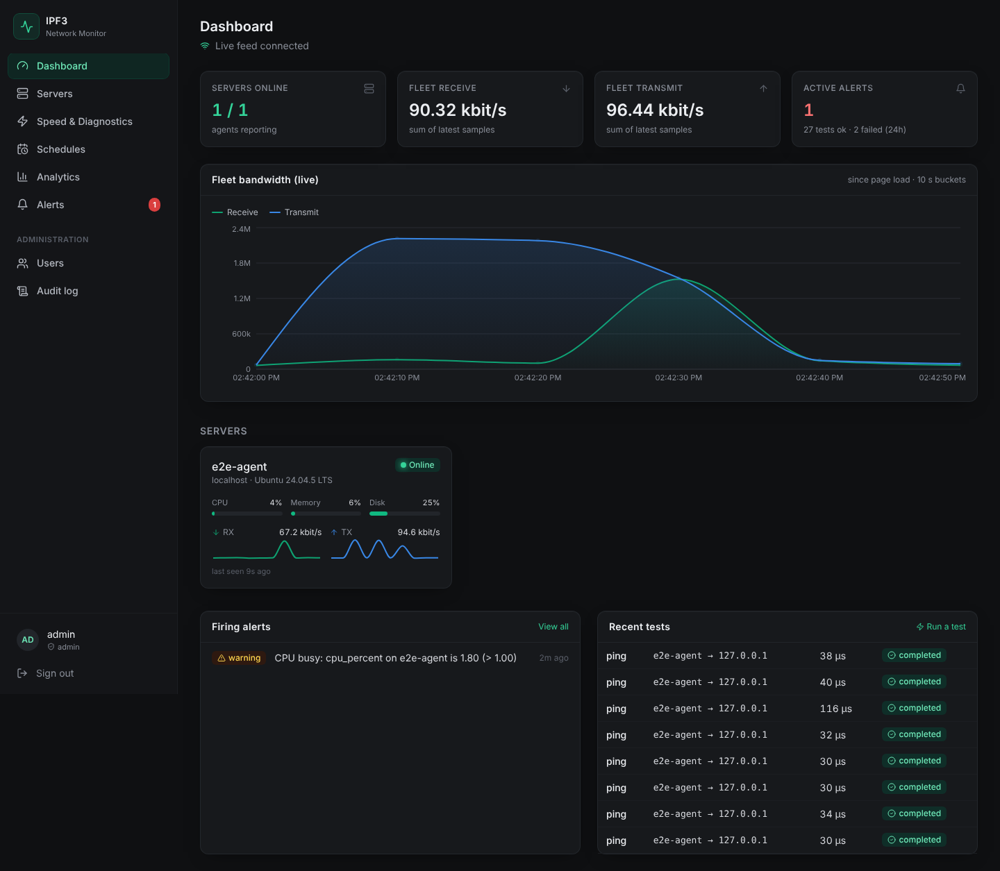
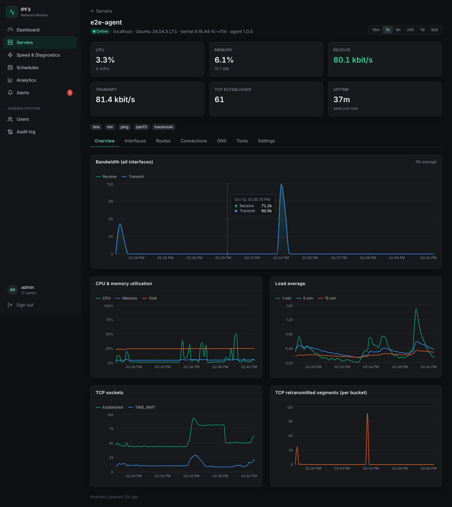
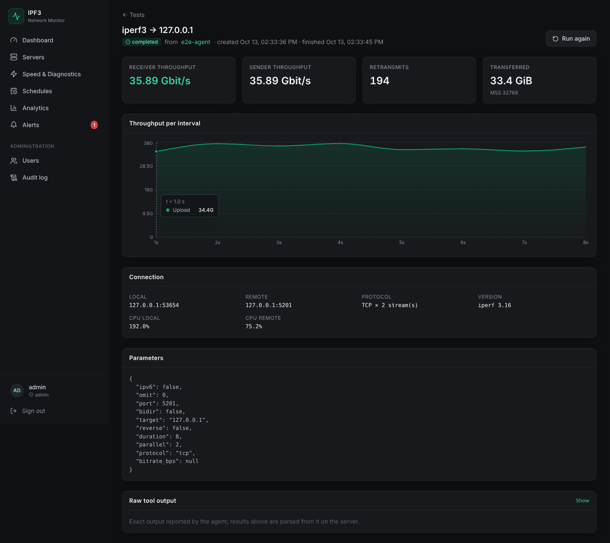
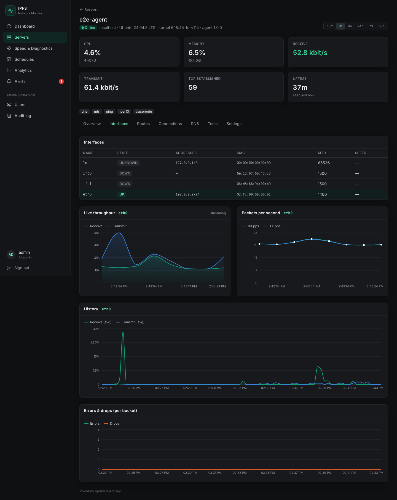
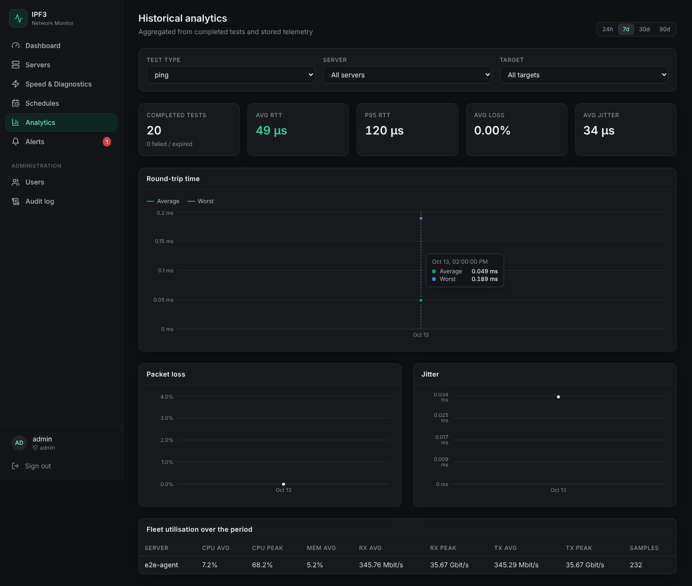

# IPF3 — Network Monitoring & Performance Testing

**English** | [فارسی](README.fa.md)

IPF3 is a self-hosted platform for monitoring a fleet of Ubuntu servers and running
network performance tests between them. It's built around **iperf3**: the agent runs
it with JSON output, and the server parses and stores the results. The web dashboard
uses a dark charcoal theme with emerald accents.

Every number on screen comes from a real measurement: kernel counters, `/proc`,
iproute2, iperf3, ping, traceroute, mtr, or a real DNS query. The UI never interpolates
or synthesises samples. A gap in reporting stays a gap on the chart.



## Features

| Area | What you get |
|---|---|
| **Multi-server monitoring** | CPU, memory, swap, disk, load, uptime, TCP states, retransmits, and per-interface bit/s, packets/s, errors and drops. Collected every 10 s from kernel counters. |
| **Real-time consumption** | Each agent reports the current rate of every interface every 2 s, measured from the kernel byte counters of the traffic actually flowing. No test traffic is generated. Bytes are also accumulated into per-day and per-month totals (download and upload) for each server and the whole fleet, kept for 3 years. Only device-backed NICs count toward host totals, so bridges, veth, tun/wg and docker interfaces don't double-count. |
| **Real-time graphs** | A WebSocket live feed for fleet and per-interface bandwidth, plus historical charts (15 min → 30 days) with server-side time bucketing (`date_bin`). |
| **Speed tests** | iperf3 TCP/UDP in upload, download (`-R`) and bidirectional modes, with parallel streams, bitrate, omit and IPv6 options. Shows per-interval throughput, retransmits, jitter, loss and CPU. |
| **Diagnostics** | Ping (RTT, loss, jitter), traceroute (UDP/ICMP/TCP), MTR, and DNS (any record type, chosen resolver, UDP/TCP, timing). |
| **Inventory** | Interfaces and addresses, IPv4/IPv6 routes from all tables, live sockets, and resolver configuration (including systemd-resolved upstreams). |
| **Schedules** | Recurring tests that feed history and alerts. Runs never stack, and bandwidth tests are rate-limited. |
| **Alerts** | Rules on system, interface, test and availability metrics. Uses sustained-condition semantics and sends webhook (Slack-compatible) and email notifications. Supports acknowledgement and history. |
| **Analytics** | Throughput, RTT (avg and p95), loss and jitter trends per server and target, plus fleet utilisation summaries. |
| **Security** | RBAC (admin / operator / viewer), argon2id passwords, account lockout, CSRF protection and an audit log. Agents get per-agent revocable credentials and one-time enrollment tokens. TLS everywhere, with least-privilege systemd sandboxes. |
| **Operations** | One-command install on Ubuntu, Alembic migrations, upgrade scripts, daily verified backups, restore, and data retention. |

## Architecture

```
 Browser ──HTTPS/WSS──► nginx ──► uvicorn (FastAPI, N workers) ──► PostgreSQL
                         │                    ▲                     ▲
                         └─ static React UI   │                     │
                                              │             ipf3-worker (schedules,
 Ubuntu host                                  │             alert evaluation, retention)
 ┌──────────────────────────────┐   HTTPS     │
 │ ipf3-agent (unprivileged,    │─────────────┘  outbound only: metrics, inventory,
 │ CAP_NET_RAW only)            │                long-poll for jobs, results
 │  ├─ /proc, psutil, ip, ss    │
 │  └─ iperf3 · ping · traceroute · mtr · DNS
 │ ipf3-iperf3 (optional iperf3 -s endpoint)
 └──────────────────────────────┘
```

Agents never accept inbound connections from the control plane. Each agent pulls jobs
over HTTPS and reports the raw tool output. The server parses that output, which is
also stored for audit, and keeps denormalised summary columns for fast analytics.
See [docs/ARCHITECTURE.md](docs/ARCHITECTURE.md).

## Quick start (production, Ubuntu 22.04 / 24.04)

On the control-plane host:

```bash
git clone https://github.com/amirali272/ipf3.git && cd ipf3
sudo ./deploy/install-server.sh --domain ipf3.example.com --tls letsencrypt --email ops@example.com
# or: --tls self-signed  |  --tls existing --cert fullchain.pem --key privkey.pem
```

The script installs PostgreSQL, nginx, the API, the worker and the web UI, and prints
the initial admin password once. Sign in, open **Servers → Enroll server**, and copy the
command it shows. Then run it on each monitored host:

```bash
git clone https://github.com/amirali272/ipf3.git && cd ipf3
sudo ./deploy/install-agent.sh --server https://ipf3.example.com --token ipf3e_… --iperf3-server
```

`--iperf3-server` also starts a sandboxed `iperf3 -s` on the host, so other servers can
run speed tests against it.

Full instructions: [docs/INSTALL.md](docs/INSTALL.md).

## Documentation

- [Installation & TLS](docs/INSTALL.md)
- [Configuration reference](docs/CONFIGURATION.md)
- [Security model & hardening](docs/SECURITY.md)
- [Operations: upgrades, backups, restore, retention, troubleshooting](docs/OPERATIONS.md)
- [HTTP API & agent protocol](docs/API.md)
- [Architecture](docs/ARCHITECTURE.md)
- [Development](docs/DEVELOPMENT.md)

## Repository layout

```
server/   FastAPI control plane (ipf3_server), Alembic migrations, pytest suite
agent/    ipf3-agent (ipf3_agent): collectors, inventory, test executor, pytest suite
web/      React 18 + TypeScript + Tailwind + Recharts dashboard (Vite)
deploy/   systemd units, nginx config, install / upgrade / backup / restore scripts
docs/     documentation
```

## Screenshots

| Server detail | iperf3 result |
|---|---|
|  |  |
| **Interfaces (live)** | **Analytics** |
|  |  |
